  

# 📑 Awesome AI-Powered Contract Metadata Extraction

  
  
  
  
  
  

> **A curated, battle-tested directory of AI-powered contract metadata extraction platforms, enterprise SaaS suites, and open-source document intelligence engines. 🌟 Star if you find this valuable! 🌟**

**Curated List of SaaS Products & Open-Source GitHub Projects**  
*Focused on Clause Extraction, OCR & Layout Pipelines, Source-Linked Registers, Obligation Tracking & Self-Hosted LLM Engines.*  
**Last updated:** November 2026

---

## 🔍 Overview & SEO Highlights

This repository benchmarks and catalogues leading **SaaS platforms** and **open-source AI pipelines** engineered for **AI-Powered Contract Metadata Extraction**, **Legal Tech Automation**, and **Document Intelligence**. These tools empower legal teams, procurement leads, contract operations, and software engineers to ingest multi-page unstructured contracts (MSAs, NDAs, SOWs, DPAs, and SLAs) at scale, reliably extracting:
- 📌 **Key Terms & Dates:** Effective dates, renewal triggers, notice windows, termination conditions.
- ⚖️ **Obligations & Covenants:** Commercial deliverables, SLA requirements, security audits, data residency.
- 🛡️ **Risk & Liability Provisions:** Indemnification caps, limitation of liability, governing law, anti-assignment clauses.
- 🔗 **Field Provenance & Citations:** Exact grounding down to bounding boxes and text spans with confidence scoring.

---

## 📑 Table of Contents

- [📊 Sector Overview & Market Dynamics](#-sector-overview--market-dynamics)
- [🏢 SaaS & Hosted Platforms](#-saas--hosted-platforms)
- [💻 Open-Source GitHub Projects](#-open-source-github-projects)
- [💡 Architectural Comparison: SaaS vs. Open Source](#-architectural-comparison-saas-vs-open-source)
- [🤝 How to Contribute](#-how-to-contribute)
- [☕ Support](#-support)
- [📈 Star History](#-star-history)
- [⚠️ Disclaimer](#-disclaimer)

---

## 📊 Sector Overview & Market Dynamics

The global **Contract Lifecycle Management (CLM) and Contract Intelligence market** is estimated at **$2.0B to $3.7B in 2026**, expanding rapidly at a CAGR of ~12% to 15% toward an estimated $10B+ by the mid-2030s.

The sector is **moderately to highly fragmented** rather than a winner-take-all monopoly. Because contract law, regulatory frameworks (e.g., GDPR, DORA, CCPA), and cross-border commercial norms vary drastically across jurisdictions and industry verticals (BFSI, healthcare, enterprise IT, supply chain), top platform leaders capture single-digit to low double-digit market share (approx. 6%–11% each). Consequently, specialized legal AI vendors (Icertis, Litera Kira, Luminance) thrive alongside enterprise cloud mega-platforms (Google Cloud, AWS, Workday) and auditable open-source extraction pipelines.

---

## 🏢 SaaS & Hosted Platforms

The table below benchmarks enterprise SaaS contract intelligence and document extraction platforms, sorted in descending order by company size (valuation / revenue scale).

| Platform 🚀 | Company Size (Valuation / Revenue) 📈 | Pricing (Starting Tier) 💵 | Free Tier / Trial Limits 🎁 | Core Extraction Strengths ⚙️ | Best For 🎯 |
| :--- | :--- | :--- | :--- | :--- | :--- |
| **[AWS Textract & Comprehend](https://aws.amazon.com/textract/)** | **~$2.2 Trillion** *(Amazon Market Cap)* | **$1.50 per 1,000 pages** *(Textract OCR)*; **$50.00 per 1,000 pages** *(Textract Key-Value Forms)*; **$0.0001 per 100 chars** *(Comprehend NLP)* | **3-Month Free Tier:** 1,000 pages/mo *(Textract Text)* + 100 pages/mo *(Forms/Tables)*; 50,000 units/mo free for 12 mos *(Comprehend)* | AWS-native serverless pipelines, key-value extraction, custom classifier training | Cloud-native engineering teams building custom scalable pipelines |
| **[Google Cloud Document AI](https://cloud.google.com/document-ai)** | **~$2.1 Trillion** *(Alphabet Market Cap)* | **$30.00 per 1,000 pages** *(Generative & Custom Extractor Workbench)*; **$1.50 per 1,000 pages** *(Enterprise OCR)* | **90-Day Free Trial:** $300 in free trial credits for new Google Cloud accounts *(no perpetual free monthly quota)* | Foundation model zero-shot/few-shot legal clause extraction, layout parsers, Vertex AI grounding | Teams wanting rapid zero-shot extraction with minimal training samples (0–50 docs) |
| **[Evisort (Workday)](https://www.evisort.com/)** | **~$70 Billion** *(Workday Market Cap; acquired for $311M)* | **~$35,000 – $60,000/year** *(Enterprise quote-based contract)* | **Sales-led Demo only:** No self-serve trial; bespoke guided enterprise evaluation on customer document sample | 54+ out-of-the-box contract models, automated conversational contract queries, Salesforce/ERP integration | Workday and enterprise ERP customers seeking automated contract-to-ledger metadata sync |
| **[Icertis AnalyticsAI](https://www.icertis.com/)** | **~$5.0 Billion** *(Valuation; ~$300M ARR)* | **~$100,000 – $150,000/year** *(Enterprise minimum deployment)* | **Sales-led Architecture Demo:** No public free tier or self-serve trial; scoped PoC via enterprise sales team | Zero-training required agentic analysis, autonomous prompt generation, revenue leakage detection | Global enterprises needing portfolio-wide metadata intelligence without full CLM setup |
| **[Hyperscience Hypercell](https://www.hyperscience.ai/)** | **~$1.6 Billion** *(Series E Valuation; ~$50M–$100M ARR)* | **~$40,000 – $60,000/year** *(Annual enterprise commitment)* | **No Free Trial:** Enterprise-only guided consultation and customized evaluation sandbox on request | Deep learning for complex long-form multi-page legal agreements, 99.5% accuracy guarantee, audit logs | High-throughput compliance and enterprise back-office document processing |
| **[Conga Discovery](https://conga.com/)** | **~$1.25 Billion** *(Valuation; ~$300M+ Revenue)* | **~$20,000 – $35,000/year** *(Standard deployment)* | **30-Day Free Trial** *(for select Conga modules via Salesforce AppExchange; core CLM via guided demo)* | Three extraction modes: OCR-only, AI-only, and Verified Extraction (AI + attorney review) | Organizations requiring hybrid automated extraction backed by human-in-the-loop attorney validation |
| **[Litera Kira (Kira Systems)](https://www.litera.com/products/legal/kira/)** | **~$1.0 Billion+** *(Litera Enterprise Portfolio; standalone acquired)* | **~$20,000 – $50,000/year** *(Mid-market/firm starter tier)* | **Discovery Demo / Pilot:** No self-serve trial; pilot environments negotiated through Litera sales | 1,400+ pre-built patented legal fields (50+ jurisdictions), Generative Smart Fields grounded in vetted clauses | Legal teams and law firms demanding rigorous, audit-defensible clause extraction |
| **[ABBYY FlexiCapture](https://www.abbyy.com/)** | **~$500 Million+** *(Estimated Enterprise Scale / Marlin Equity)* | **~$15,000 – $25,000/year** *(Base license + volume packages)* | **7-Day Free Trial** *(up to 100 pages for desktop/cloud capture; 30-day trial for Timeline analytics)* | Hybrid NLP + structured FlexiLayouts, segmentation pre-processing, high-volume multi-lingual OCR | Regulated institutions handling mixed batches of structured forms and unstructured contracts |
| **[Rossum](https://rossum.ai/)** | **~$250 Million** *(Series A/B Valuation; ~$18M ARR)* | **$18,000/year** *($1,500/month equivalent, 1-year minimum commitment)* | **14-Day Free Trial** *(Access to AI document engine and validation interface)* | Computer vision-based document gateway, exception handling workflows, bidirectional ERP connectors | Transactional document operations bridging contract metadata into accounts payable/ERP |
| **[Luminance (Lumi AI)](https://www.luminance.com/)** | **~$150 Million – $200 Million** *(Series C; ~$30M–$60M ARR)* | **~$43,000 – $60,000/year** *(Average entry deployment)* | **Sales-led Custom Demo:** No self-serve trial; custom enterprise proof-of-value sandbox | Proprietary legal LLM ("Panel of Judges"), document family linkers (amendments + side letters), source citation | Legal ops and corporate counsel seeking conversational multi-document portfolio Q&A |

---

## 💻 Open-Source GitHub Projects

The table below lists notable open-source repositories and engines for self-hosted contract extraction, legal NLP, and document intelligence, sorted in descending order by **GitHub Stars_Count**. Each Stars_Badge links directly to that repository's stargazers page.

| Repository 📦 | GitHub_Stars ⭐ | License 📜 | Tech Stack 🛠️ | Extraction Focus & Architecture 🔍 |
| :--- | :--- | :--- | :--- | :--- |
| **[docling-project/docling](https://github.com/docling-project/docling)** |  | MIT | Python, PyTorch, C++ | IBM Research layout parser and document conversion engine. Preserves complex multi-column legal clauses, tables, and hierarchical headings for LLM contract extraction. |
| **[Unstructured-IO/unstructured](https://github.com/Unstructured-IO/unstructured)** |  | Apache-2.0 | Python, ONNX, LayoutLM | Leading open ingestion pipeline for unstructured legal documents. Partitions PDFs into clean semantic elements, tables, and metadata chunks ready for vector search and metadata tagging. |
| **[Open-Source-Legal/OpenContracts](https://github.com/Open-Source-Legal/OpenContracts)** |  | Apache-2.0 | Python, Django, React, Celery | Open-source enterprise Document Management System (DMS) tailored for contract review. Supports bounding-box PDF extraction, human-in-the-loop annotation, and LLM-assisted clause analysis. |
| **[LexPredict/lexpredict-lexnlp](https://github.com/LexPredict/lexpredict-lexnlp)** |  | MIT | Python, Scikit-learn, NLTK | Classical legal NLP library for extracting dates, monetary values, entity names, citations, obligations, and custom contract expressions without cloud dependencies. |
| **[The-Atticus-Project/cuad](https://github.com/The-Atticus-Project/cuad)** |  | CC-BY-4.0 | Python, PyTorch, Transformers | The benchmark Contract Understanding Atticus Dataset and fine-tuning baseline. Features 510 commercial contracts labeled across 41 crucial legal clause categories for supervised fine-tuning. |
| **[LexPredict/lexpredict-contraxsuite](https://github.com/LexPredict/lexpredict-contraxsuite)** |  | AGPL-3.0 | Python, Celery, PostgreSQL | Open-source document analytics and contract extraction engine for law firms and enterprise legal ops. Includes rules-based and ML-based contract provision classifiers. |
| **[contract-obligation-extraction](https://github.com/ishandutta2007/Awesome-AI-Powered-Contract-Metadata-Extraction)** |  | MIT | Python 3.12, FastAPI, Pydantic | Specialized deterministic post-signature contract obligation extractor. Produces structured registers of deliverables, risk flags, and deadlines with exact source clause citations. |
| **[ContractVault](https://github.com/ishandutta2007/Awesome-AI-Powered-Contract-Metadata-Extraction)** |  | MIT | Python, SQLite, Git CLI | Lightweight post-signature contract CLI for field extraction, deadline calendar exports (`.ics`), deterministic provenance tracking, and PII masking. |

---

## 💡 Architectural Comparison: SaaS vs. Open Source

When architecting an automated contract extraction pipeline, consider the following structural dimensions:

1. **Defensibility & Provenance 🛡️:**
   - *Enterprise SaaS:* Platforms like Litera Kira leverage curated proprietary field libraries (1,400+ fields) grounded in legal expert hours to prevent hallucinations.
   - *Open Source:* OpenContracts and Docling allow local grounding with full transparency over token coordinates and text anchors.
2. **Data Privacy & Compliance 🔒:**
   - Privileged legal agreements, NDAs, and customer DPAs often restrict cloud processing. Open-source stacks run air-gapped on private VPCs or on-prem hardware with zero telemetry.
3. **Turnkey vs. Custom Engineering ⚙️:**
   - Commercial platforms offer ready-to-use UIs, human-in-the-loop review queues, and direct Salesforce/Workday integrations.
   - Open-source solutions provide modular primitives (OCR, layout parsing, LLM prompting) that can be integrated into custom microservices.

---

## 🤝 How to Contribute

Contributions are welcome! Help us keep this directory accurate and exhaustive:

1. 🍴 **Fork** the repository.
2. 🌿 Create a descriptive branch: `git checkout -b add/new-extractor-tool`.
3. 📝 Update `README.md` following the tabular formatting with factual data (starting price, free tier limit, Stars_Badges).
4. 🚀 Open a **Pull Request** explaining your addition.

---

## ☕ Support

If this curated repository saved you hours of research or helped optimize your legal-tech stack, please consider supporting the project:

- ⭐ **Star this repository** to improve discoverability!
- 🍴 **Fork and share** with your legal engineering and contract operations peers.
- ☕ **Buy a coffee & sponsor ongoing maintenance:** [Sponsor ishandutta2007 on GitHub](https://github.com/sponsors/ishandutta2007)

Your sponsorship fuels continuous evaluation of new models, benchmarks, and legal document intelligence tools!

---

## 📈 Star History

---

## ⚠️ Disclaimer

- This is a **community-curated directory** intended for educational and engineering research purposes.
- Mentions of commercial SaaS platforms or open-source libraries do not constitute an endorsement.
- Contracts contain confidential, legally privileged, and regulated information (GDPR, CCPA, HIPAA). Always conduct thorough security audits, data processing reviews, and penetration tests before routing agreements through any AI model or pipeline.
